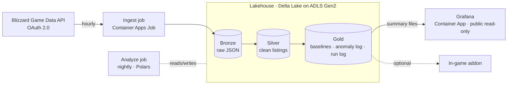

# Ironforge Exchange Commission (IFEC)

**Market surveillance and post-mortem analytics for the World of Warcraft: Forever auction house.**

IFEC watches the auction house the way a securities regulator watches a stock market. It is not a trading tool: it does not tell anyone what to buy or sell. It records the market every hour, keeps the full history, and every night it checks the data for anomalies such as price spikes, supply crashes and abnormal volume. Every finding goes into an audit log that you can review afterwards.

WoW: Forever launches on 4 November 2026, so there is a rare chance to watch an economy from day zero: no price history at first, then price discovery, inflation, crashes and patch shocks.

> **Status:** design phase. Nothing is deployed yet.

---

## Why "Exchange Commission"?

| Real world | IFEC |
|---|---|
| The SEC runs market surveillance (e.g. MIDAS) to find manipulation and abnormal trading | Nightly anomaly detection on auction house prices and volumes |
| Regulators keep an audit trail and do post-incident investigations | An anomaly log you can never change, plus post-mortem dashboards |
| Central banks publish macro statistics (inflation, baselines) | 7-day and 30-day moving-average baselines per item |

The project shows two skill sets together: **DevOps / platform engineering** (IaC, containers, scheduled pipelines, cost control) and a **risk and controls mindset** (surveillance, audit trail, evidence-based findings).

---

## Architecture (planned)

| Layer | Choice |
|---|---|
| Cloud | Microsoft Azure (Sweden Central): everything in one subscription, no servers |
| Infrastructure as Code | Terraform, applied from GitHub Actions with OIDC (no stored cloud secrets) |
| Jobs | Python containers as Azure Container Apps Jobs: ingest hourly, analyze nightly |
| Lakehouse | Delta Lake on ADLS Gen2, Bronze → Silver → Gold. The single source of truth, with full version history |
| Analytics | Polars + delta-rs: rolling means, std. deviation, Z-scores, volume deltas |
| Visualization | Grafana as a Container App (scales to zero), dashboards provisioned from git |
| Monitoring | Run log table in the lakehouse + Azure Monitor alerts on job failure |
| Secrets | Azure Key Vault + managed identities |
| Optional | WoW addon that shows IFEC findings in the game, via a small desktop sync helper |

### Cost target

**Hard cap of $15 per month; the design costs about $1–2.** No VM and no database server: the lakehouse is cheap object storage, and the jobs and Grafana run on the Container Apps consumption plan, which scales to zero. An Azure budget alert enforces the cap.

---

## Roadmap

1. **Ingestion:** Blizzard OAuth 2.0, rate-limit handling, local snapshot capture
2. **Infrastructure:** Docker image, Terraform for Azure (storage, VM, scheduling), end-to-end cloud run
3. **Analytics:** flatten snapshots, compute baselines and Z-scores, define anomaly thresholds
4. **Visualization:** Gold summary files, anomaly log, Grafana dashboards as code, public endpoint
5. **Optional:** in-game addon to show the findings

---

## Disclaimer

Fan project, not affiliated with or endorsed by Blizzard Entertainment. World of Warcraft and Warcraft are trademarks of Blizzard Entertainment, Inc.
